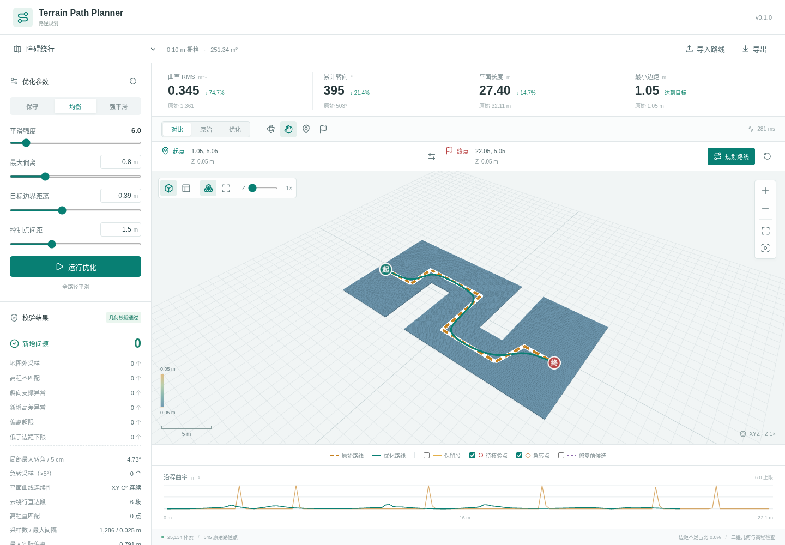

# Terrain Path Planner

[简体中文](README.md) | [English](README.en.md)

可通行体素图上的路径搜索与全路径平滑，提供独立 Python 算法包和 Three.js 三维可视化。

算法先在保留高程的体素图中寻找路线，再在原路线走廊内消除多余绕行、联合优化整条曲线。可视化支持手动选择起终点、切换高程层、调整参数、对比曲率与边距，并导出完整结果。运行不依赖机器人、ROS 或其他业务 Server。

当前提供 Python 实现。C++ 版本尚未实现，后续将按同一数据格式与回归用例移植，见 [项目架构](docs/architecture.md)。



## 快速开始

需要 Python 3.10+、Node.js 20.19+（推荐 22.12+），以及支持 WebGL 2 的浏览器。

```bash
git clone https://github.com/deng-weihong/terrain-path-planner.git
cd terrain-path-planner
python3 -m venv .venv
.venv/bin/python -m pip install -e '.[web,test]'
npm ci
npm run build
npm start
```

打开 <http://localhost:5181>。默认使用可重复生成的“障碍绕行”示例，不需要下载现场地图。

仅使用算法：

```bash
.venv/bin/python -m pip install -e .
.venv/bin/python examples/plan_route.py
```

前端开发时分别运行 `npm start` 和 `npm run dev`，访问 <http://localhost:5182>。npm 命令优先使用项目 `.venv`；也可以用 `PATH_PLANNER_PYTHON` 指定 Python。

## 算法链路

```text
可通行 XYZ 体素 + 起终点
  -> 三维邻接图 / 坡度与台阶 / 连通分量
  -> 含边距偏好的图搜索
  -> 原始路线与允许偏离走廊
  -> 最远可见点缩短绕行
  -> 三次 B-Spline 全局控制点优化
  -> 地面高程匹配与边距修正
  -> 单条 C² 平面样条约束细化
  -> 密集采样校验 / 指标 / 导出
```

三维图搜索与最终曲线校验的范围不同：搜索保留完整 XYZ 邻接关系，平滑主要优化 XY，并单独检查地面高度层。最终曲线尚未重新通过完整三维图逐边校验；边距是可通行区域 XY 投影的距离场估计，未包含机器人外形。原路线已有问题会单独保留计数，`newViolationCount = 0` 不等于全部校验通过。详见 [算法原理与约束](docs/algorithm.md)。

## 验证

```bash
npm test
npm run benchmark
npm run build
npx playwright install chromium
npm run test:web
```

浏览器检查会启动临时本地 API，验证桌面、笔记本和手机视口下的 WebGL 像素、三维交互、起终点规划、导入导出与失败恢复。截图和指标写入 `artifacts/`。

## 目录

```text
src/terrain_planner/  Python 算法、数据模型和可选可视化接口
web/                  Vue + Three.js 可视化
tests/                算法、接口与浏览器检查
examples/             可直接运行的最小调用示例
docs/                 原理、格式、开发与发布说明
scripts/              开发命令与源码归档
data/                 数据使用约定；本地地图放入 local/
```

## 文档

- [算法原理](docs/algorithm.md)：图搜索、走廊、样条目标函数、地形与校验。
- [项目架构](docs/architecture.md)：模块边界、执行链和 C++ 移植边界。
- [数据格式与 API](docs/data-format.md)：地图、路线、参数、任务与导出。
- [开发与验证](docs/development.md)：环境、测试、基准和三维渲染。
- [源码整理与发布](docs/releasing.md)：归档内容、许可证状态和发布步骤。
- [贡献说明](CONTRIBUTING.md) 与 [代码来源及依赖](NOTICE.md)。

项目许可证尚未选定，尚未发布正式授权发行版。
