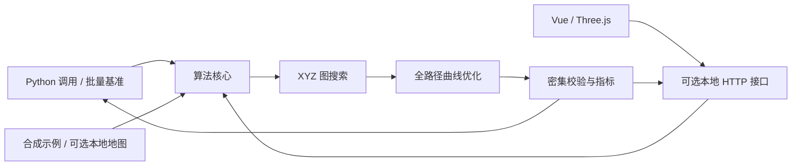

# 项目架构

[简体中文](architecture.md) | [English](en/architecture.md)

## 运行边界

项目可以单独复制、安装和运行。算法不调用业务 Server，不连接机器人，不需要 ROS。浏览器通过本项目的可选 HTTP 接口获取地图和计算结果；Python 调用者可以直接使用算法包。



## 模块职责

| 文件 | 职责 | 主要依赖 |
| --- | --- | --- |
| `planning_types.py` | 坐标、栅格转换、图输入和搜索结果 | Python 标准库 |
| `global_planner.py` | 三维邻接、连通性、图缓存、搜索、可选原有后处理 | Python 标准库与本地类型 |
| `optimizer.py` | 距离场、走廊、B-Spline、约束细化、校验与指标 | NumPy、SciPy |
| `planner.py` | 端点高程校验、精确端点规划、结果元数据 | 本地算法模块 |
| `datasets.py` | 示例生成、可选文件数据集、地图描述 | NumPy；PNG 预览按需使用 Pillow |
| `viewer.py` | 异步任务、地图下载、结果导出、静态页面 | FastAPI、Uvicorn |
| `benchmark.py` | 固定场景和预设的批量指标对比 | 本地算法模块 |
| `web/mapScene.ts` | 三维几何、路线、相机、射线点选、资源释放 | Three.js |
| `web/MapCanvas.vue` | 地图加载、视图状态、指针和触摸交互 | Vue |
| `web/App.vue` | 参数、规划任务、历史、指标与导入导出 | Vue |

`__init__.py` 提供核心 Python 入口，不导入 HTTP 接口。安装基础依赖即可搜路和平滑；安装 `[web]` 后才需要 FastAPI、Uvicorn、Pillow。

## 两条计算入口

**端点规划：** 端点选择 -> 高程层校验 -> 精确端点 XYZ 图搜索 -> `sourceRoute` -> 全路径优化 -> 校验与指标。

**已有路线：** 样本或导入路线 -> 输入校验 -> 全路径优化 -> 校验与指标。

参数重跑保留上次的 `sourceRoute`，不把密集输出曲线重新当作地形原始路线。任务阶段分别为 `planning` 和 `optimizing`。

接口使用一个工作线程处理算法任务，同一时刻接受一个计算；冲突请求返回 409。任务保存在内存中，最多保留 24 个；前端历史最多保留最近 5 次。服务重启后任务和历史不会持久化。

## 数据和生成物

合成示例由代码生成，随源码归档。现场数据位于 `data/local/`，只供本机运行和可选回归使用。地图也可通过 `PATH_PLANNER_DATA_DIR` 从其他目录读取。

`node_modules/`、`.venv/`、`dist/`、`build/`、`artifacts/`、`releases/` 和本地地图不进入源码归档。归档使用明确的文件白名单，不依赖外层工作区是否已经建立 Git 仓库。

## C++ 版本的后续边界

当前提供 Python 实现，C++ 算法尚未实现。计划采用以下结构：

```text
cpp/
  CMakeLists.txt
  include/terrain_planner/  公共类型和算法接口
  src/                      图、距离场、样条和求解器
  tests/                    CTest 与跨语言回归
  examples/                 CLI 和最小调用
```

移植对象包括完整 XYZ 图搜索、原始路线走廊、直达检查、全路径平滑和几何校验；不能只移植转角圆弧，也不能通过启动 Python 进程冒充 C++ 实现。

双方复用地图编码、米制坐标、参数含义和结果字段。搜索优先核对可达性、精确端点、楼层和台阶规则；优化优先核对约束、曲率、长度和失败分类。不同数值求解器允许合理浮点差异，容差应通过同一测试数据和指标明确规定，不能假定逐点完全一致。

最终需要分别验证：独立库构建、无 Web 的 CLI、与 Python 的结果对比，以及由同一三维界面加载 C++ 结果。CMake、数值依赖和可视化连接方式在实际移植时确定。
