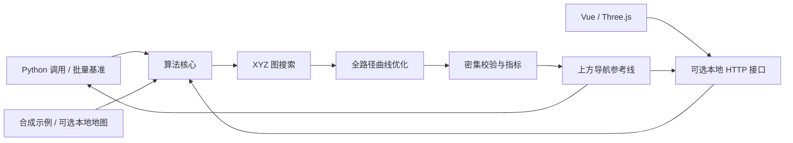

# 项目架构

[简体中文](architecture.md) | [English](en/architecture.md)

## 运行边界

项目可以单独复制、安装和运行。算法不调用业务 Server，不连接机器人，不需要 ROS。浏览器通过本项目的可选 HTTP 接口获取地图和计算结果；Python 调用者可以直接使用算法包。



## 模块职责

| 文件 | 职责 | 主要依赖 |
| --- | --- | --- |
| `planning_types.py` | 坐标、栅格转换、图输入和搜索结果 | Python 标准库 |
| `global_planner.py` | 三维邻接、连通性、图缓存、搜索、可选原有后处理 | Python 标准库与本地类型 |
| `optimizer.py` | 距离场、走廊、B-Spline、约束细化、校验与指标 | NumPy、SciPy |
| `planner.py` | 端点高程校验、精确端点规划、结果元数据 | 本地算法模块 |
| `datasets.py` | 示例生成、可选文件数据集、地图描述 | NumPy；PNG 预览按需使用 Pillow |
| `viewer.py` | 异步任务、地图下载、结果导出、静态页面 | FastAPI、Uvicorn |
| `benchmark.py` | 固定场景和预设的批量指标对比 | 本地算法模块 |
| `web/mapScene.ts` | 三维几何、路线、相机、射线点选、资源释放 | Three.js |
| `web/MapCanvas.vue` | 地图加载、视图状态、指针和触摸交互 | Vue |
| `web/App.vue` | 参数、规划任务、历史、指标与导入导出 | Vue |

`__init__.py` 提供核心 Python 入口，不导入 HTTP 接口。安装基础依赖即可搜路和平滑；安装 `[web]` 后才需要 FastAPI、Uvicorn、Pillow。

## 两条计算入口

**端点规划：** 端点选择 -> 高程层校验 -> 精确端点 XYZ 图搜索 -> `sourceRoute` -> 全路径优化 -> 校验与指标。

**已有路线：** 样本或导入路线 -> 输入校验 -> 全路径优化 -> 校验与指标。

输出保留 `path` 作为地面支撑路线和 `validation` 的检查对象；独立的 `navigationPath` 共享 XY 并生成平滑的上方参考高度。显示主线使用后者，导出保留两者，点选和搜索端点继续使用地面坐标。

参数重跑保留上次的 `sourceRoute`，不把密集输出曲线重新当作地形原始路线。任务阶段分别为 `planning` 和 `optimizing`。

接口使用一个工作线程处理算法任务，同一时刻接受一个计算；冲突请求返回 409。`engine` 可以为 `python` 或 `cpp`；C++ 任务通过 JSON 调用原生可执行文件，搜索和平滑均在 C++ 中执行。任务保存在内存中，最多保留 24 个；前端历史最多保留最近 5 次。服务重启后任务和历史不会持久化。

## 数据和生成物

合成示例由代码生成，随源码归档。现场数据位于 `data/local/`，只供本机运行和可选回归使用。地图也可通过 `PATH_PLANNER_DATA_DIR` 从其他目录读取。

`node_modules/`、`.venv/`、`dist/`、`build/`、`artifacts/`、`releases/` 和本地地图不进入源码归档。归档使用明确的文件白名单，不依赖外层工作区是否已经建立 Git 仓库。

## C++ 原生实现

C++17 库、CLI、示例和 CTest 已实现，结构为：

```text
cpp/
  CMakeLists.txt
  include/terrain_planner/  公共类型和算法接口
  src/                      图、距离场、样条、求解器与 JSON CLI
  tests/                    原生 CTest 回归
  examples/                 CLI 和最小调用
tests/test_native.py         Python / C++ 交叉回归
```

核心库的公共接口只使用 C++ 标准库类型，算法依赖 Eigen 和 LBFGSpp；JSON 适配单独依赖 nlohmann/json。`GraphPlanner` 持有不可变地图及邻接图，可重复查询不同端点；修改地图需要新建对象。CLI 直接调用原生算法，不启动 Python 进程。

双方复用地图编码、米制坐标、参数含义和结果字段。图搜索对应页面的精确端点原始路线入口，不包含 Python 图模块中未启用的旧局部圆角后处理。C++ 的自然平滑样条使用稀疏线性系统直接求解，与 SciPy 的数值实现允许浮点差异。

验证包括原生测试、独立库安装消费、CLI、跨语言回归与同一三维界面的 C++ 规划和导出。构建和数值容差见 [C++ 使用与原理](cpp.md)。
