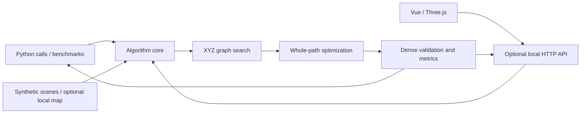

# Architecture

[简体中文](../architecture.md) | [English](architecture.md)

## Runtime Boundaries

The project can be copied, installed, and run independently. The algorithm does not call an external application server, connect to a robot, or require ROS. The browser uses this project's optional HTTP API to load maps and results. Python callers can invoke the algorithm package directly.



## Modules

| File | Responsibility | Main Dependencies |
| --- | --- | --- |
| `planning_types.py` | Coordinates, voxel conversion, graph input, and search results | Python standard library |
| `global_planner.py` | 3D adjacency, connectivity, graph cache, search, and optional original postprocessing | Python standard library and local types |
| `optimizer.py` | Distance fields, corridor constraints, B-splines, refinement, validation, and metrics | NumPy, SciPy |
| `planner.py` | Endpoint elevation validation, exact endpoint search, and metadata | Local algorithm modules |
| `datasets.py` | Scene generation, optional file datasets, and map descriptions | NumPy; Pillow loaded on demand for PNG previews |
| `viewer.py` | Asynchronous jobs, map downloads, exports, and static frontend | FastAPI, Uvicorn |
| `benchmark.py` | Repeated scene and preset comparisons | Local algorithm modules |
| `web/mapScene.ts` | 3D geometry, routes, cameras, raycasting, and resource disposal | Three.js |
| `web/MapCanvas.vue` | Map loading, view state, pointer and touch handling | Vue |
| `web/App.vue` | Parameters, planning jobs, history, metrics, and import/export | Vue |

`__init__.py` exposes the core Python API without importing the HTTP interface. Base dependencies support search and smoothing; FastAPI, Uvicorn, and Pillow are needed for the `[web]` extra.

## Execution Paths

**Endpoint planning:** endpoint selection -> elevation validation -> exact XYZ graph search -> `sourceRoute` -> whole-path optimization -> validation and metrics.

**Existing route:** sample or imported route -> input validation -> whole-path optimization -> validation and metrics.

Rerunning parameters preserves the original `sourceRoute`. Dense output samples do not replace the original terrain vertices. Job phases are `planning` and `optimizing`.

The API uses one worker thread and accepts one calculation at a time. Conflicting submissions return 409. Select `python` or `cpp` using `engine`; C++ jobs invoke the native executable through JSON, with both search and smoothing performed in C++. Jobs are held in memory, with at most 24 retained; the viewer keeps the five most recent results. Jobs and viewer history are not persisted across restarts.

## Data and Generated Files

Synthetic scenes are generated by code and included in source archives. Recorded data in `data/local/` is used only for local runs and optional regressions. `PATH_PLANNER_DATA_DIR` can point to a map elsewhere.

Source archives exclude `node_modules/`, `.venv/`, `dist/`, `build/`, `artifacts/`, `releases/`, and local maps. An explicit allowlist controls archive contents, independently of whether the surrounding workspace is a Git repository.

## Native C++ Implementation

The C++17 library, CLI, examples, and CTest regressions are implemented:

```text
cpp/
  CMakeLists.txt
  include/terrain_planner/  Public types and algorithm interfaces
  src/                      Graph, distance fields, splines, solvers, and JSON CLI
  tests/                    Native CTest regressions
  examples/                 CLI and minimal usage
tests/test_native.py         Python / C++ cross-language regressions
```

The core public interface uses standard C++ types. Algorithms depend on Eigen and LBFGSpp; the separate JSON adapter uses nlohmann/json. `GraphPlanner` owns an immutable map and adjacency graph and supports repeated endpoint queries. Construct a new planner after changing the map. The CLI calls native algorithms directly and does not launch Python.

Both implementations share map encoding, metric coordinates, parameter meanings, and result fields. C++ graph search matches the viewer's exact-endpoint raw-route entry point. It does not expose the old local corner-rounding postprocessor retained in the Python graph module. Native natural smoothing splines use a sparse linear system; floating-point differences from SciPy are expected.

Verification covers native tests, installing and consuming the library, the CLI, cross-language regressions, and C++ planning and export through the same 3D viewer. See [C++ Usage and Design](cpp.md) for builds and numerical tolerances.
