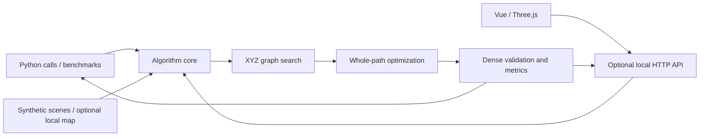

# Architecture

[简体中文](../architecture.md) | [English](architecture.md)

## Runtime Boundaries

The project can be copied, installed, and run independently. The algorithm does not call an external application server, connect to a robot, or require ROS. The browser uses this project's optional HTTP API to load maps and results. Python callers can invoke the algorithm package directly.



## Modules

| File | Responsibility | Main Dependencies |
| --- | --- | --- |
| `planning_types.py` | Coordinates, voxel conversion, graph input, and search results | Python standard library |
| `global_planner.py` | 3D adjacency, connectivity, graph cache, search, and optional original postprocessing | Python standard library and local types |
| `optimizer.py` | Distance fields, corridor constraints, B-splines, refinement, validation, and metrics | NumPy, SciPy |
| `planner.py` | Endpoint elevation validation, exact endpoint search, and metadata | Local algorithm modules |
| `datasets.py` | Scene generation, optional file datasets, and map descriptions | NumPy; Pillow loaded on demand for PNG previews |
| `viewer.py` | Asynchronous jobs, map downloads, exports, and static frontend | FastAPI, Uvicorn |
| `benchmark.py` | Repeated scene and preset comparisons | Local algorithm modules |
| `web/mapScene.ts` | 3D geometry, routes, cameras, raycasting, and resource disposal | Three.js |
| `web/MapCanvas.vue` | Map loading, view state, pointer and touch handling | Vue |
| `web/App.vue` | Parameters, planning jobs, history, metrics, and import/export | Vue |

`__init__.py` exposes the core Python API without importing the HTTP interface. Base dependencies support search and smoothing; FastAPI, Uvicorn, and Pillow are needed for the `[web]` extra.

## Execution Paths

**Endpoint planning:** endpoint selection -> elevation validation -> exact XYZ graph search -> `sourceRoute` -> whole-path optimization -> validation and metrics.

**Existing route:** sample or imported route -> input validation -> whole-path optimization -> validation and metrics.

Rerunning parameters preserves the original `sourceRoute`. Dense output samples do not replace the original terrain vertices. Job phases are `planning` and `optimizing`.

The API uses one worker thread and accepts one calculation at a time. Conflicting submissions return 409. Jobs are held in memory, with at most 24 retained; the viewer keeps the five most recent results. Jobs and viewer history are not persisted across restarts.

## Data and Generated Files

Synthetic scenes are generated by code and included in source archives. Recorded data in `data/local/` is used only for local runs and optional regressions. `PATH_PLANNER_DATA_DIR` can point to a map elsewhere.

Source archives exclude `node_modules/`, `.venv/`, `dist/`, `build/`, `artifacts/`, `releases/`, and local maps. An explicit allowlist controls archive contents, independently of whether the surrounding workspace is a Git repository.

## Planned C++ Port

The current implementation is Python. C++ algorithms have not been implemented yet. The planned layout is:

```text
cpp/
  CMakeLists.txt
  include/terrain_planner/  Public types and algorithm interfaces
  src/                      Graph, distance fields, splines, and solvers
  tests/                    CTest and cross-language regressions
  examples/                 CLI and minimal usage
```

The port will cover full XYZ graph search, the original route corridor, visibility shortcuts, whole-path smoothing, and geometric validation. A corner-rounding routine alone is insufficient, and invoking a Python process is not a native C++ implementation.

Both implementations should share map encoding, metric coordinates, parameter meanings, and result fields. Search comparisons should first verify reachability, exact endpoints, floor separation, and step rules. Smoothing comparisons should verify constraints, curvature, length, and failure classification. Different numerical solvers may produce small floating-point differences; tolerances must be specified using shared test data and metrics rather than assuming pointwise equality.

Verification will cover an independently built library, a CLI without the Web interface, comparisons with Python, and loading C++ results in the same 3D viewer. CMake details, numerical dependencies, and viewer integration will be selected during implementation.
